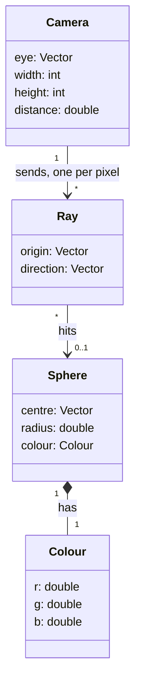

# Domain model

## Diagram

## Words

| Word | Meaning |
|---|---|
| Camera | The eye, where rays start, and a screen of `width` × `height` pixels, `distance` in front of the eye. For now it always looks along +z. |
| Ray | A half-line: a starting point and a direction. The point at distance `t` is `origin + t × direction`. |
| Sphere | A ball, given by its centre, its radius and its colour. |
| Colour | Red, green and blue, each from 0 to 1. |
| Vector | Three numbers `x`, `y`, `z`. Used for points and for directions. |
| Trace | Gives the colour a ray sees: the sphere's colour if it hits it, black if not. |

## Answered questions

- **Is a colour a Vector?** No, see [ADR 0006](../adr/0006-colour-is-its-own-class.md).
- **Who colours the pixel?** The `trace` function, in `src/render/`. `main` only prints the result.

## Open questions

- Are a point and a direction the same class? Today both are `Vector`.
