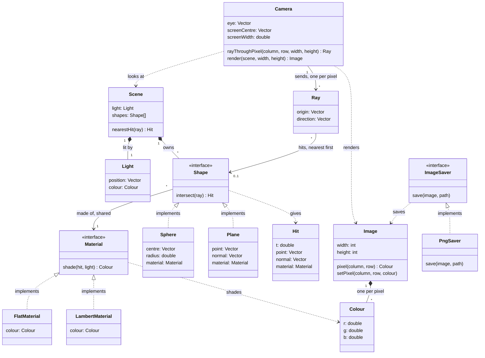

# Domain model

## Diagram

## Words

| Word | Meaning |
|---|---|
| Camera | The eye, where rays start, and a screen in front of it, given by its centre and its width. For now the screen faces along +z. |
| Pixel | One square of the image, counted by `column` (from the left) and `row` (from the top). Its ray goes from the eye through its centre. |
| Ray | A half-line: a starting point and a direction. The point at distance `t` is `origin + t × direction`. |
| Scene | Everything the camera looks at: the shapes and the light. It owns its shapes. |
| Light | Where the light comes from (one point) and its colour. It plays the part of the sun. |
| Shape | Anything a ray can hit. It answers one question: where does this ray first hit me, in front of its origin? |
| Sphere | A ball, given by its centre, its radius and its material. |
| Plane | A flat surface with no edges, such as the floor. Given by one point on it, its normal and its material. |
| Hit | Where a ray meets a shape: the distance `t`, the point, the normal (length 1) and the shape's material. In code: `HitInfo`. |
| Nearest hit | Of all the shapes a ray hits, the one with the smallest `t`. The scene finds it. |
| Material | What a surface is made of. It shades: it gives the colour a ray sees at a hit, under the light. One class per kind of material. |
| Flat material | One colour everywhere. It ignores the light. |
| Lambert material | A matte surface: the more it faces the light, the brighter it is (`normal · direction to light`, never below 0). |
| Colour | Red, green and blue, each from 0 to 1. |
| Vector | Three numbers `x`, `y`, `z`. Used for points and for directions. |
| Trace | Gives the colour a ray sees: the nearest hit, shaded by its material under the scene's light. Black if the ray hits nothing. |
| Render | Make an image of the size asked for: one ray per pixel, traced, and its colour stored. |
| Image | A grid of pixels, each with a colour. Column 0, row 0 is the top left pixel. Every pixel starts black. |
| Save | Write an image to a file. An `ImageSaver` does it, one class per file format. Today: PNG. |

## Answered questions

- **Is a colour a Vector?** No, see [ADR 0006](../adr/0006-colour-is-its-own-class.md).
- **Who colours the pixel?** `trace`, in `src/render/`. `Camera::render` calls it once per pixel.
- **Who finds what a ray hits?** The scene: it asks every shape and keeps the nearest hit.
- **Where does a hit's colour come from?** From the shape's material, see [ADR 0009](../adr/0009-materials-are-a-strategy.md).
- **Does a sphere trace itself?** No. Finding the nearest object and handling lights concern the whole scene, not one sphere, see [ADR 0009](../adr/0009-materials-are-a-strategy.md).
- **How are the world and the image counted?** See [ADR 0008](../adr/0008-coordinates.md).
- **Does an image save itself?** No. The client said "we save it to a file", but `Image` would then know about PNG. A saver saves it, see [ADR 0007](../adr/0007-png-output-with-lodepng.md).

## Simplifications

- Every surface is plastic: one colour, no metal or glass. A simplification for the course, not a client need.
- Today a surface is matte (Lambert) or flat. The white highlight of plastic comes next, as a new `Material`.
- One light, given as a point.

## Not done yet

- Shadows: a point facing the light is lit even if another shape is in the way.
- Reflection.
- A ray that hits nothing is black, not sky blue.
