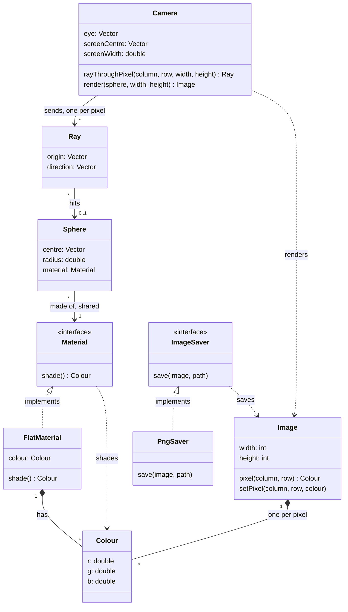

# Domain model

## Diagram

## Words

| Word | Meaning |
|---|---|
| Camera | The eye, where rays start, and a screen in front of it, given by its centre and its width. For now the screen faces along +z. |
| Pixel | One square of the image, counted by `column` (from the left) and `row` (from the top). Its ray goes from the eye through its centre. |
| Ray | A half-line: a starting point and a direction. The point at distance `t` is `origin + t × direction`. |
| Sphere | A ball, given by its centre, its radius and its material. |
| Material | What a surface is made of. It shades: it gives the colour a ray sees on the surface. One class per kind of material. |
| Flat material | A material with one colour everywhere, with no light or shadow. |
| Colour | Red, green and blue, each from 0 to 1. |
| Vector | Three numbers `x`, `y`, `z`. Used for points and for directions. |
| Trace | Gives the colour a ray sees: what the sphere's material shades if the ray hits it, black if not. |
| Render | Make an image of the size asked for: one ray per pixel, traced, and its colour stored. |
| Image | A grid of pixels, each with a colour. Every pixel starts black. |
| Save | Write an image to a file. An `ImageSaver` does it, one class per file format. Today: PNG. |

## Answered questions

- **Is a colour a Vector?** No, see [ADR 0006](../adr/0006-colour-is-its-own-class.md).
- **Who colours the pixel?** `trace`, in `src/render/`. `Camera::render` calls it once per pixel.
- **Where does a hit's colour come from?** From the sphere's material, see [ADR 0009](../adr/0009-materials-are-a-strategy.md).
- **Does a sphere trace itself?** No. Finding the nearest object and handling lights concern the whole scene, not one sphere, see [ADR 0009](../adr/0009-materials-are-a-strategy.md).
- **How are the world and the image counted?** See [ADR 0008](../adr/0008-coordinates.md).
- **Does an image save itself?** No. The client said "we save it to a file", but `Image` would then know about PNG. A saver saves it, see [ADR 0007](../adr/0007-png-output-with-lodepng.md).

## Simplifications

- Every surface is plastic: one colour, no metal or glass. A simplification for the course, not a client need.
- Today the only material is flat: one colour, no light. Plastic, with light, comes next as a new `Material`.

