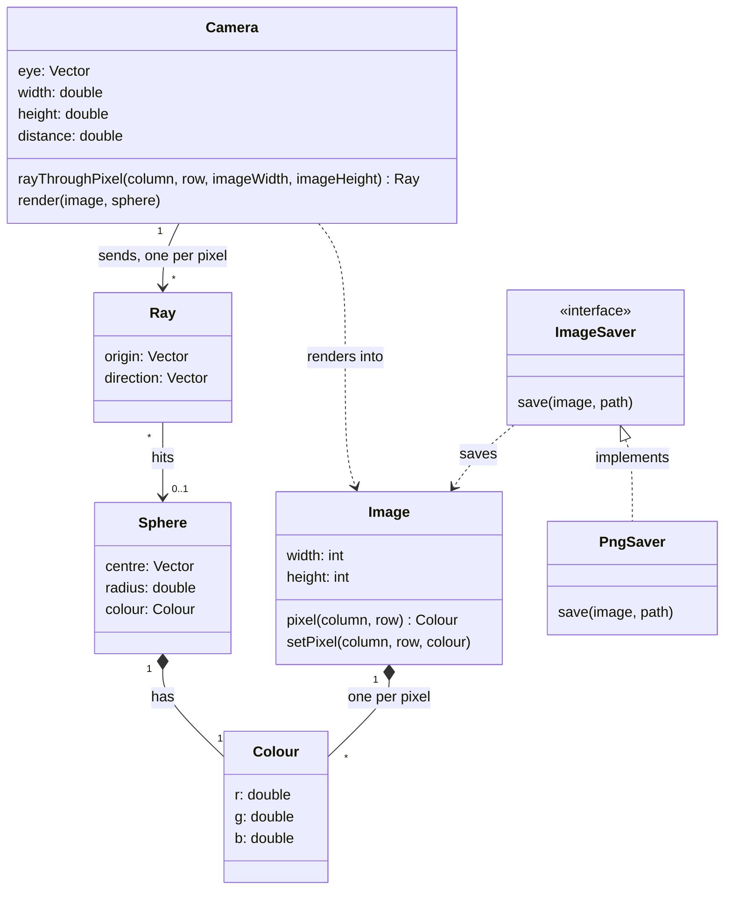

# Domain model

## Diagram

## Words

| Word | Meaning |
|---|---|
| Camera | The eye, where rays start, and a screen `width` × `height` in world units, `distance` in front of the eye. For now it always looks along +z. |
| Pixel | One square of the image, counted by `column` (from the left) and `row` (from the top). Its ray goes from the eye through its centre. |
| Ray | A half-line: a starting point and a direction. The point at distance `t` is `origin + t × direction`. |
| Sphere | A ball, given by its centre, its radius and its colour. |
| Colour | Red, green and blue, each from 0 to 1. |
| Vector | Three numbers `x`, `y`, `z`. Used for points and for directions. |
| Trace | Gives the colour a ray sees: the sphere's colour if it hits it, black if not. |
| Render | Send one ray per pixel, trace it, and fill the image. |
| Image | A grid of pixels, each with a colour. Every pixel starts black. |
| Save | Write an image to a file. An `ImageSaver` does it, one class per file format. Today: PNG. |

## Answered questions

- **Is a colour a Vector?** No, see [ADR 0006](../adr/0006-colour-is-its-own-class.md).
- **Who colours the pixel?** `trace`, in `src/render/`. `Camera::render` calls it once per pixel.
- **How are the world and the image counted?** See [ADR 0008](../adr/0008-coordinates.md).
- **Does an image save itself?** No. The client said "we save it to a file", but `Image` would then know about PNG. A saver saves it, see [ADR 0007](../adr/0007-png-output-with-lodepng.md).

## Simplifications

- Every surface is plastic: one colour, no metal or glass. A simplification for the course, not a client need.

