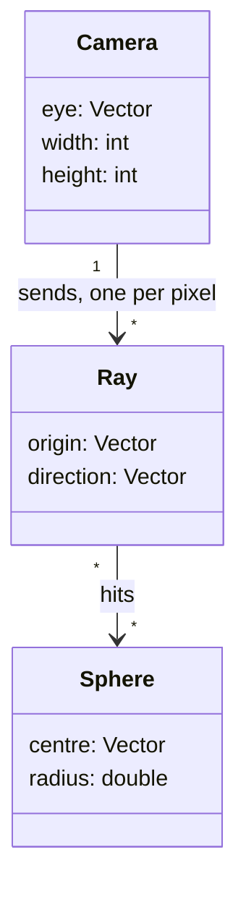

# Domain model

## Diagram

## Words

| Word | Meaning |
|---|---|
| Camera | The eye, where rays start, and a screen of `width` × `height` pixels in front of it. |
| Ray | A half-line: a starting point and a direction. The point at distance `t` is `origin + t × direction`. |
| Sphere | A ball, given by its centre and its radius. |
| Vector | Three numbers `x`, `y`, `z`. Used for points and for directions. |
